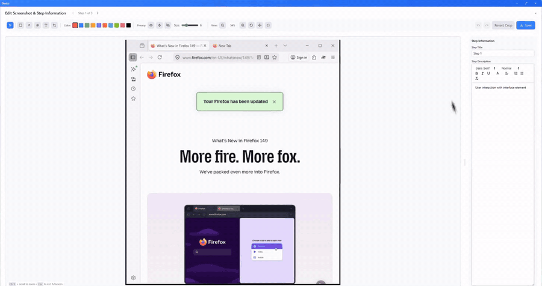
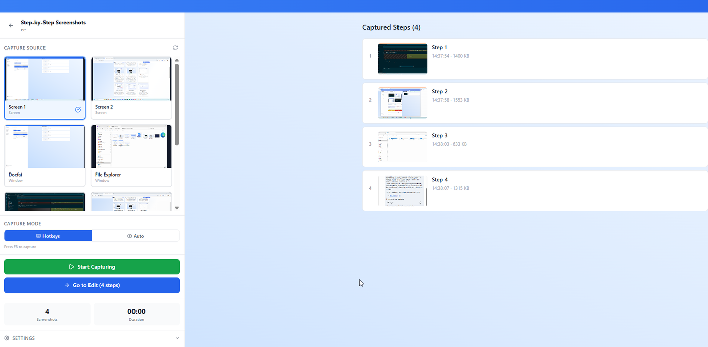
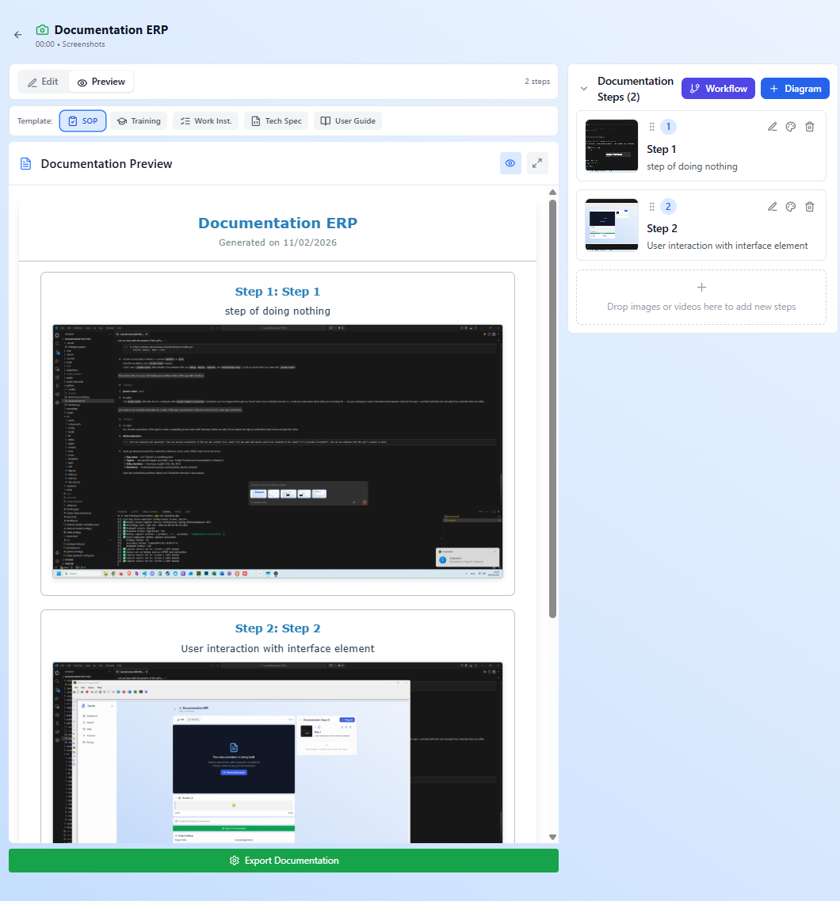
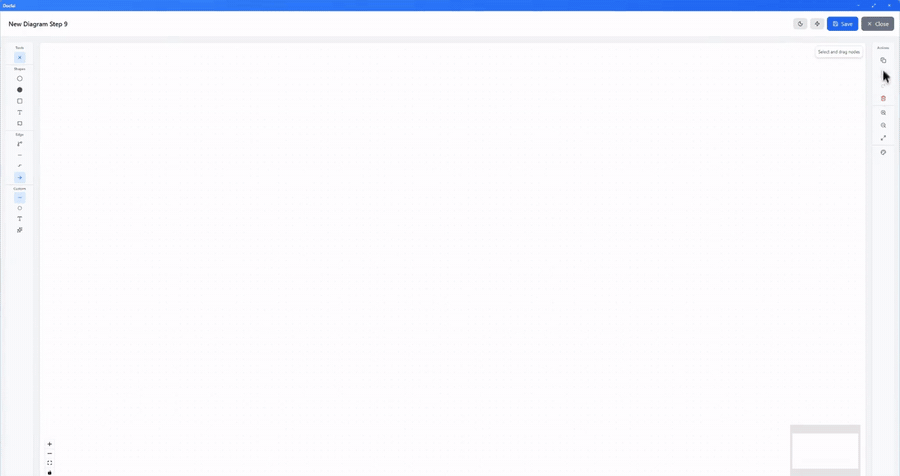
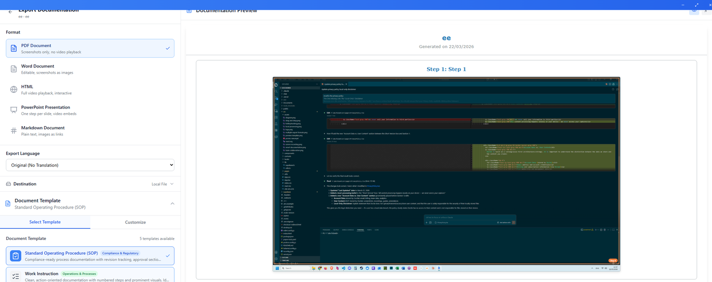

# Docfai

Docfai is a Windows desktop app that turns screen recordings into step-by-step guides.



- Record your screen, or capture a screenshot on every click with auto-capture. Windows UI Automation names the element you clicked ("Click the Save button").
- Pull steps out of an existing video by detecting scene changes.
- Edit steps with annotations, highlights and blur, and add flowcharts.
- Export to PDF, DOCX, PPTX, HTML, Markdown or video, using templates (SOP, user guide, technical spec).

Everything runs locally. There are no accounts, no telemetry and no cloud services.

## Screenshots

**Capture steps** with a hotkey, or automatically on every click:



**Edit and preview** the guide with a document template:



**Add workflow diagrams** to any step:



**Export** to PDF, Word, HTML, PowerPoint or Markdown:



## Download and install

1. Go to the [latest release](https://github.com/Julienbase/Docfai/releases/latest). You can also find it under **Releases** on the right side of this page.
2. Under **Assets**, download **`Docfai-Setup-<version>.exe`**.
3. Run the file and follow the installer.

Requires Windows 10 or 11 (64-bit).

The installer is not code-signed, so Windows SmartScreen may show "Windows protected your PC". Click **More info**, then **Run anyway**. Each release lists the installer's SHA-256 checksum if you want to verify the download.

## Building from source

### Requirements

- Windows 10 or 11 (x64)
- Node.js 22 or later
- Visual Studio Build Tools with the "Desktop development with C++" workload. `npm install` compiles the native click-capture module (`src/native/`) with node-gyp.
- Internet access on the first build, to download Electron, NSIS and FFmpeg

### Development

```powershell
npm install
npm run electron-dev
```

`electron-dev` downloads FFmpeg into `vendor/` the first time, then starts Vite and Electron.

### Build the installer

```powershell
npm run dist
```

The installer is written to `release/Docfai-Setup-<version>.exe`.

Builds are **unsigned**, so Windows SmartScreen will warn when you run the installer. To sign builds, add your own signing setup to `electron-builder.config.js` (see the electron-builder documentation on Windows code signing).

#### Optional build settings

| Environment variable | Effect |
|---|---|
| `DOCFAI_UPDATE_URL` | Set at build time to enable auto-update from a generic update feed (an electron-builder `latest.yml` and installers hosted at that URL). Without it, the app never checks for updates. |
| `DOCFAI_TRANSLATION_URL` | Set when running the app to enable the optional offline translation module. Build it with `npm run build-translation-module` (needs a local Python runtime and Argos models in `python/`). Without it, translation shows as unavailable. |

### Checks

```powershell
npm run check   # TypeScript
npm run lint
npm test
```

## Releasing

Releases are built and published by GitHub Actions ([`.github/workflows/release.yml`](.github/workflows/release.yml)):

1. Bump `version` in `package.json` (for example to `1.0.49`) and commit it to `main`.
2. Tag that commit with the same version and push the tag:

   ```powershell
   git tag v1.0.49
   git push origin v1.0.49
   ```

The workflow checks that the tag matches `package.json`, runs the typecheck and tests, builds the installer, and publishes a GitHub Release with the installer, its SHA-256 checksum and generated release notes.

To test a build without publishing, run the **Release** workflow manually from the Actions tab. The installer is attached to the run as an artifact for 7 days.

## Known issues

- Windows only.
- `npm run lint` reports existing errors (mostly unused imports and `any` types). `npm run check` and `npm test` pass.
- `npm audit --omit=dev --audit-level=high` (also run in CI) fails on `extract-zip` and `image-size`. `extract-zip` has no fixed version yet; it only extracts the hash-verified translation module.

## License

Docfai is released under the [MIT License](LICENSE). Bundled third-party software, including FFmpeg (GPL-3.0-or-later), is listed in [THIRD-PARTY-NOTICES.txt](THIRD-PARTY-NOTICES.txt).

The MIT License covers the code. It doesn't grant rights to the Docfai name or logo.
